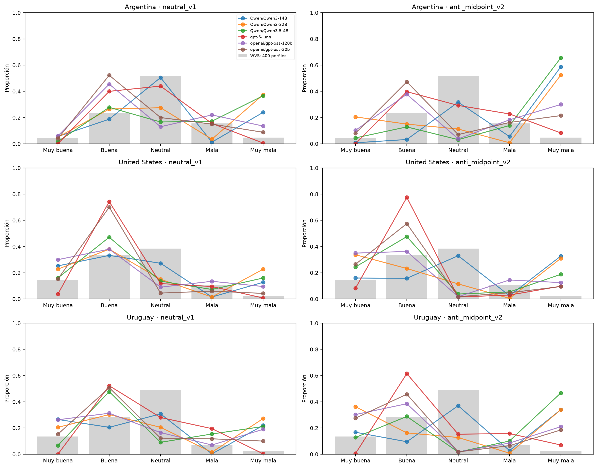
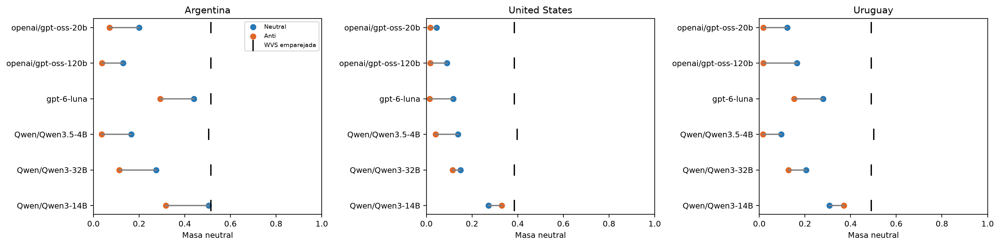
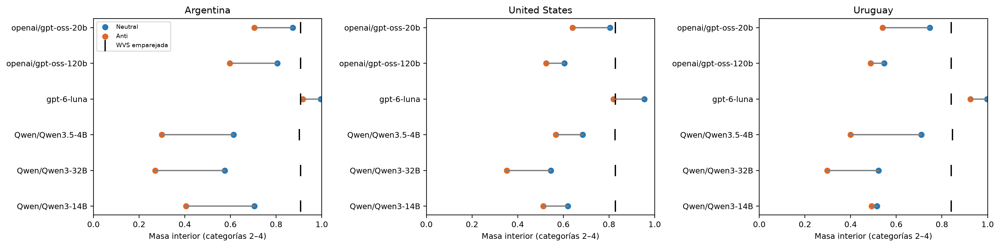
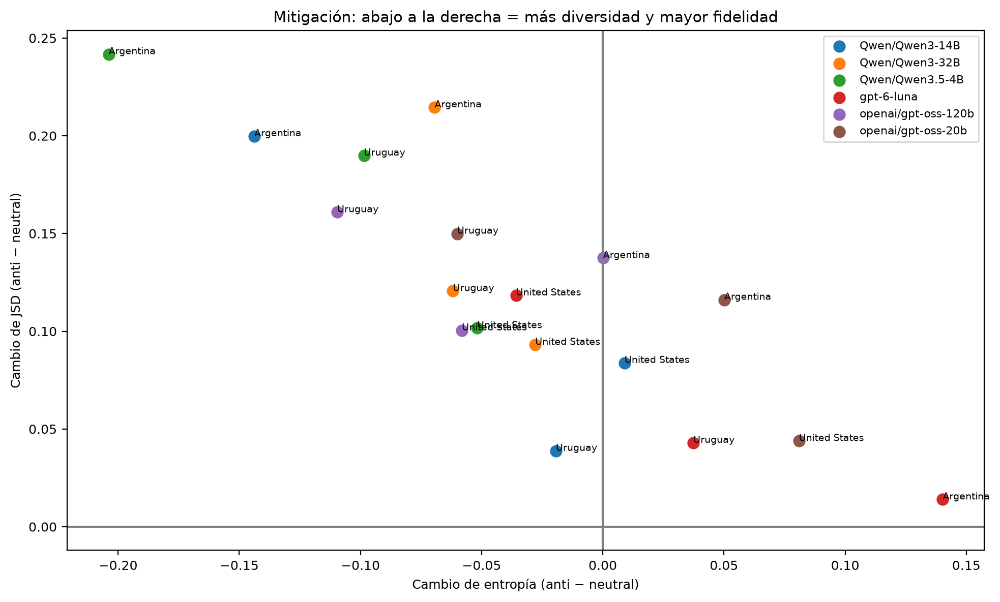
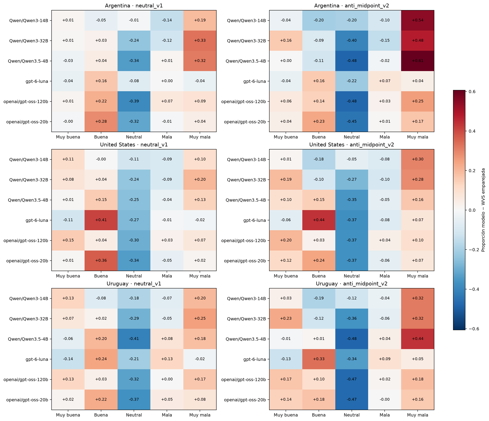
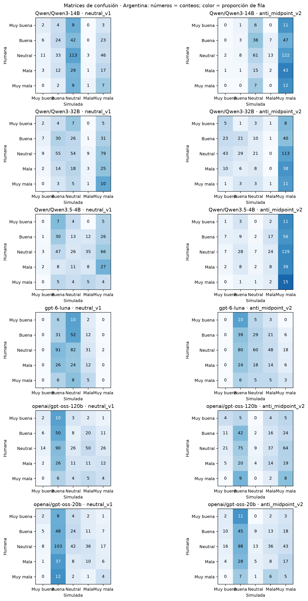
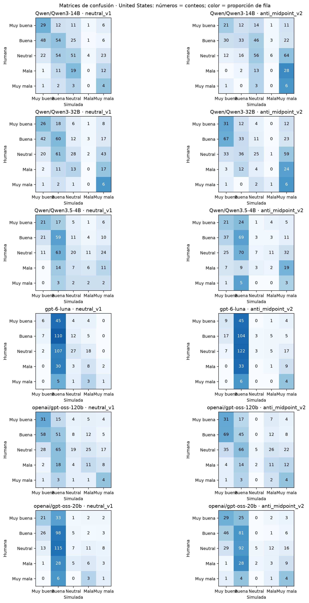
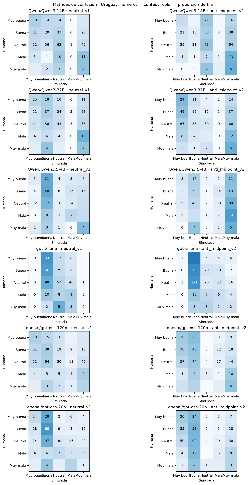
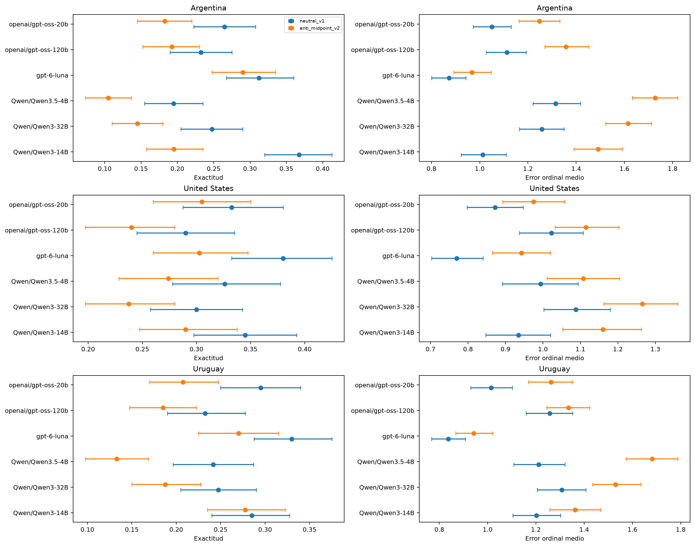
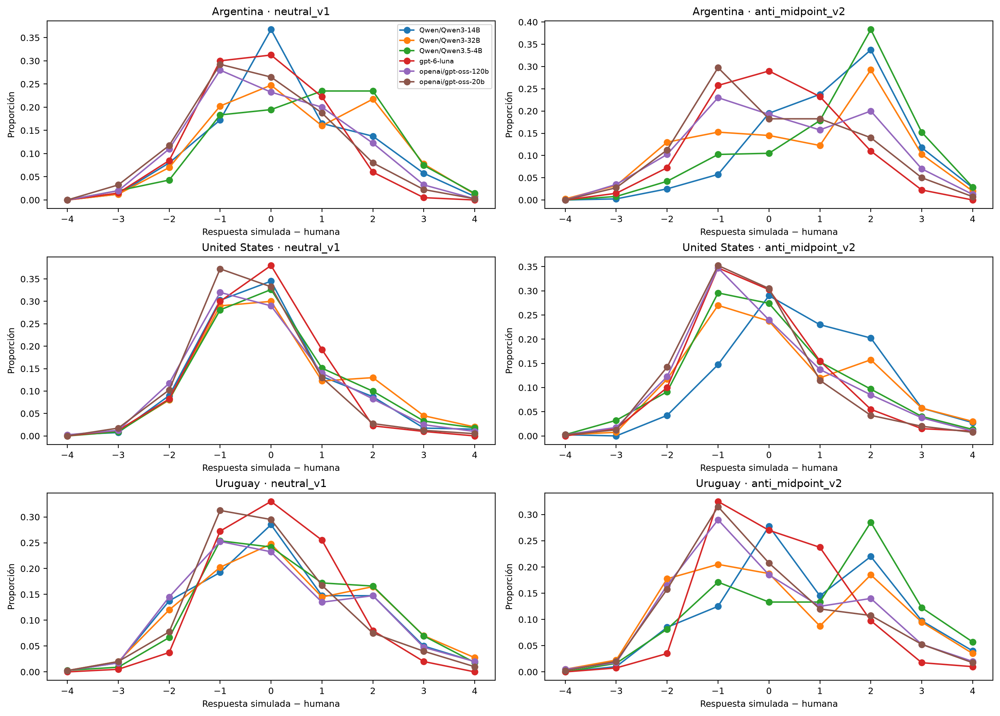

# Resultados Q121

Se auditaron 13 archivos. El dataset unificado y el análisis usan 12 corridas, 14,400 intentos y 14,132 respuestas válidas, sobre 1,200 perfiles.

## Archivo adicional

La corrida c8cc559dc6ee47fa contiene 21 intentos (12 válidos) de Qwen3.5-4B, con thinking=True y 4096 tokens. Se excluye del dataset y del análisis porque la corrida completa usa thinking=False y 512 tokens. Solo queda documentada en la auditoría.

## Calidad y cobertura

- Qwen/Qwen3.5-4B, Argentina, anti_midpoint_v2: 19/400 perfiles sin respuesta válida (4.7%).

- Qwen/Qwen3.5-4B, United States, anti_midpoint_v2: 28/400 perfiles sin respuesta válida (7.0%).

- Qwen/Qwen3.5-4B, Uruguay, anti_midpoint_v2: 32/400 perfiles sin respuesta válida (8.0%).

- Qwen/Qwen3.5-4B, Argentina, neutral_v1: 51/400 perfiles sin respuesta válida (12.7%).

- Qwen/Qwen3.5-4B, United States, neutral_v1: 69/400 perfiles sin respuesta válida (17.2%).

- Qwen/Qwen3.5-4B, Uruguay, neutral_v1: 69/400 perfiles sin respuesta válida (17.2%).

## Dispersión, neutralidad y fidelidad

- anti_midpoint_v2: entropía menor que la humana en 9/18 celdas; exceso neutral en 0/18; exceso interior en 2/18. JSD media por celda: 0.249; W1 media: 0.770.

- neutral_v1: entropía menor que la humana en 5/18 celdas; exceso neutral en 0/18; exceso interior en 3/18. JSD media por celda: 0.130; W1 media: 0.471.

## Desempeño individual

- Qwen/Qwen3-14B, anti_midpoint_v2: exactitud válida 25.4%; sobre todos los perfiles 25.4%; error ordinal medio 1.337 (0–4).

- Qwen/Qwen3-14B, neutral_v1: exactitud válida 33.2%; sobre todos los perfiles 33.2%; error ordinal medio 1.050 (0–4).

- Qwen/Qwen3-32B, anti_midpoint_v2: exactitud válida 19.0%; sobre todos los perfiles 19.0%; error ordinal medio 1.470 (0–4).

- Qwen/Qwen3-32B, neutral_v1: exactitud válida 26.5%; sobre todos los perfiles 26.5%; error ordinal medio 1.218 (0–4).

- Qwen/Qwen3.5-4B, anti_midpoint_v2: exactitud válida 17.0%; sobre todos los perfiles 15.9%; error ordinal medio 1.507 (0–4).

- Qwen/Qwen3.5-4B, neutral_v1: exactitud válida 25.3%; sobre todos los perfiles 21.3%; error ordinal medio 1.176 (0–4).

- gpt-6-luna, anti_midpoint_v2: exactitud válida 28.7%; sobre todos los perfiles 28.7%; error ordinal medio 0.951 (0–4).

- gpt-6-luna, neutral_v1: exactitud válida 34.1%; sobre todos los perfiles 34.1%; error ordinal medio 0.827 (0–4).

- openai/gpt-oss-120b, anti_midpoint_v2: exactitud válida 20.6%; sobre todos los perfiles 20.6%; error ordinal medio 1.269 (0–4).

- openai/gpt-oss-120b, neutral_v1: exactitud válida 25.2%; sobre todos los perfiles 25.2%; error ordinal medio 1.131 (0–4).

- openai/gpt-oss-20b, anti_midpoint_v2: exactitud válida 23.2%; sobre todos los perfiles 23.2%; error ordinal medio 1.162 (0–4).

- openai/gpt-oss-20b, neutral_v1: exactitud válida 29.8%; sobre todos los perfiles 29.8%; error ordinal medio 0.979 (0–4).

## Cambio del prompt, sobre perfiles válidos comunes

- Qwen/Qwen3-14B: cambio medio entre países de neutralidad -0.023, entropía -0.051, JSD +0.107, W1 +0.539, exactitud -7.8%, MAE +0.288.

- Qwen/Qwen3-32B: cambio medio entre países de neutralidad -0.092, entropía -0.053, JSD +0.143, W1 +0.333, exactitud -7.5%, MAE +0.252.

- Qwen/Qwen3.5-4B: cambio medio entre países de neutralidad -0.103, entropía -0.118, JSD +0.178, W1 +0.401, exactitud -8.4%, MAE +0.340.

- gpt-6-luna: cambio medio entre países de neutralidad -0.126, entropía +0.047, JSD +0.058, W1 +0.088, exactitud -5.3%, MAE +0.124.

- openai/gpt-oss-120b: cambio medio entre países de neutralidad -0.104, entropía -0.056, JSD +0.133, W1 +0.220, exactitud -4.6%, MAE +0.138.

- openai/gpt-oss-20b: cambio medio entre países de neutralidad -0.088, entropía +0.024, JSD +0.103, W1 +0.244, exactitud -6.6%, MAE +0.182.

La JSD mejora en 0/18 pares modelo/país; la exactitud en 0/18. Hay 9 alertas de posible sobrecorrección.

**No se observa exceso de respuestas neutrales frente a los humanos en ninguna celda.** La hipótesis de sesgo hacia el punto medio no se sostiene descriptivamente en estas corridas. Reducir más la neutralidad no resuelve ese problema y puede aumentar la distancia respecto de WVS.

**El prompt anti-punto-medio empeora la fidelidad de distribución y la exactitud en los 18 pares modelo/país.** Este patrón descriptivo favorece el prompt neutral para estos datos; las diferencias de entorno impiden una atribución causal exclusiva al prompt.

## Lectura de las matrices de confusión

- Qwen/Qwen3-14B, anti_midpoint_v2: el desacuerdo más frecuente, sumando países, es humano «Neither good, nor bad» → modelo «Rather bad» (250 casos). El error con signo promedio es +0.882.

- Qwen/Qwen3-14B, neutral_v1: el desacuerdo más frecuente, sumando países, es humano «Neither good, nor bad» → modelo «Quite good» (123 casos). El error con signo promedio es +0.107.

- Qwen/Qwen3-32B, anti_midpoint_v2: el desacuerdo más frecuente, sumando países, es humano «Neither good, nor bad» → modelo «Rather bad» (240 casos). El error con signo promedio es +0.333.

- Qwen/Qwen3-32B, neutral_v1: el desacuerdo más frecuente, sumando países, es humano «Neither good, nor bad» → modelo «Rather bad» (175 casos). El error con signo promedio es +0.296.

- Qwen/Qwen3.5-4B, anti_midpoint_v2: el desacuerdo más frecuente, sumando países, es humano «Neither good, nor bad» → modelo «Rather bad» (250 casos). El error con signo promedio es +0.723.

- Qwen/Qwen3.5-4B, neutral_v1: el desacuerdo más frecuente, sumando países, es humano «Neither good, nor bad» → modelo «Quite good» (187 casos). El error con signo promedio es +0.361.

- gpt-6-luna, anti_midpoint_v2: el desacuerdo más frecuente, sumando países, es humano «Neither good, nor bad» → modelo «Quite good» (323 casos). El error con signo promedio es -0.021.

- gpt-6-luna, neutral_v1: el desacuerdo más frecuente, sumando países, es humano «Neither good, nor bad» → modelo «Quite good» (296 casos). El error con signo promedio es -0.093.

- openai/gpt-oss-120b, anti_midpoint_v2: el desacuerdo más frecuente, sumando países, es humano «Neither good, nor bad» → modelo «Quite good» (215 casos). El error con signo promedio es +0.011.

- openai/gpt-oss-120b, neutral_v1: el desacuerdo más frecuente, sumando países, es humano «Neither good, nor bad» → modelo «Quite good» (219 casos). El error con signo promedio es -0.048.

- openai/gpt-oss-20b, anti_midpoint_v2: el desacuerdo más frecuente, sumando países, es humano «Neither good, nor bad» → modelo «Quite good» (280 casos). El error con signo promedio es -0.165.

- openai/gpt-oss-20b, neutral_v1: el desacuerdo más frecuente, sumando países, es humano «Neither good, nor bad» → modelo «Quite good» (315 casos). El error con signo promedio es -0.216.

## Pruebas exploratorias

- neutral_mass: delta media -0.089; Wilcoxon p=0.0156, Holm p=0.1094; rank-biserial=-1.000; test de signos p=0.0156.

- IM: delta media -0.170; Wilcoxon p=0.0156, Holm p=0.1094; rank-biserial=-1.000; test de signos p=0.0156.

- H_norm: delta media -0.035; Wilcoxon p=0.9531, Holm p=1.0000; rank-biserial=-0.714; test de signos p=0.8906.

- JSD: delta media +0.120; Wilcoxon p=1.0000, Holm p=1.0000; rank-biserial=+1.000; test de signos p=1.0000.

- W1: delta media +0.304; Wilcoxon p=1.0000, Holm p=1.0000; rank-biserial=+1.000; test de signos p=1.0000.

- accuracy: delta media -0.067; Wilcoxon p=1.0000, Holm p=1.0000; rank-biserial=-1.000; test de signos p=1.0000.

- MAE: delta media +0.221; Wilcoxon p=1.0000, Holm p=1.0000; rank-biserial=+1.000; test de signos p=1.0000.

## Interpretación y límites

Las comparaciones de prompts usan los mismos perfiles válidos en ambas condiciones. Las tablas de métricas individuales usan todos los válidos de cada corrida. La referencia principal son sus respuestas humanas emparejadas; se conserva una comparación adicional con los 400 perfiles por país.

Los intervalos bootstrap (2000 réplicas, semilla 42) remuestrean pares humano/modelo. Describen variación de perfiles, no variación de nuevas generaciones del modelo. Los tests conjuntos usan un promedio de países por modelo, no 18 observaciones independientes.

La falta de respuestas válidas puede seleccionar perfiles; se informa exactitud con y sin penalización de fallos. No se imputa el contenido de una respuesta inválida.

La versión de Transformers cambia entre prompts locales y los modelos tienen configuraciones distintas. Los efectos son asociaciones entre corridas: no identifican un efecto causal puro del prompt ni permiten atribuir diferencias exclusivamente a la arquitectura.

Una sola pregunta, tres países, seis modelos relacionados y una generación por perfil limitan la generalización. Los valores p son exploratorios, con Holm por ámbito. No se aplican pesos de encuesta.

La adaptación de Q130 cambia log₂(4) por log₂(5), mide la masa neutral directamente y define masa interior como categorías 2–4. MAE y W1 suponen intervalos ordinales unitarios.

## Figuras

Barras grises: muestra WVS completa por país. Líneas: respuestas válidas de cada modelo. Los picos muestran concentración. En Qwen3.5-4B la cobertura difiere; las métricas principales usan su referencia humana emparejada.

Cada segmento compara los prompts en los mismos perfiles. La marca negra indica neutralidad humana: acercarse a ella es más informativo que simplemente disminuir la neutralidad.

Adaptación directa del gráfico del tutorial: masa en categorías interiores frente a WVS. Una caída de esta masa equivale a un aumento de respuestas extremas; solo indica mejora si acerca la distribución a la humana.

Abajo a la derecha: aumenta diversidad y disminuye divergencia. Arriba a la derecha: aumenta diversidad pero se aleja de los humanos. La diversidad sola no demuestra una mejora.

Rojo indica sobrerrepresentación y azul subrepresentación. Cada fila compara un modelo con los humanos de sus mismos perfiles válidos. El color tiene una escala compartida.

La diagonal contiene coincidencias exactas. Los números son conteos; el color se normaliza por respuesta humana para hacer visibles categorías poco frecuentes. Las celdas sin denominador quedan sin color.

La diagonal contiene coincidencias exactas. Los números son conteos; el color se normaliza por respuesta humana para hacer visibles categorías poco frecuentes. Las celdas sin denominador quedan sin color.

La diagonal contiene coincidencias exactas. Los números son conteos; el color se normaliza por respuesta humana para hacer visibles categorías poco frecuentes. Las celdas sin denominador quedan sin color.

Puntos e intervalos bootstrap del 95% sobre respuestas válidas. Mayor exactitud y menor error son mejores; el solapamiento de intervalos no sustituye una comparación apareada.

Cero = coincidencia exacta. Errores negativos: el modelo evalúa la inmigración más positivamente que el humano; positivos: más negativamente. Colas lejanas de cero indican desacuerdos grandes.